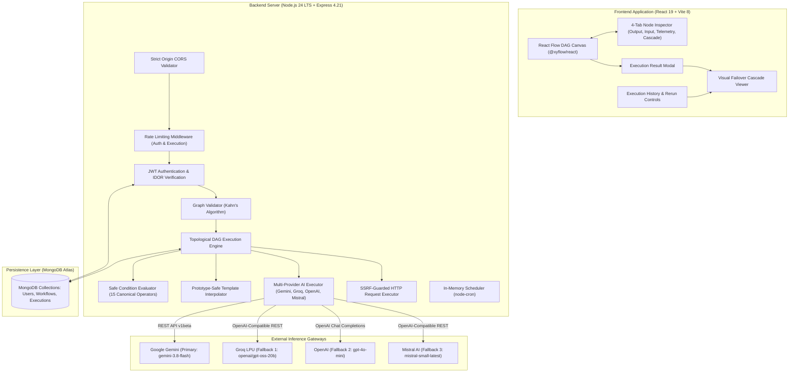
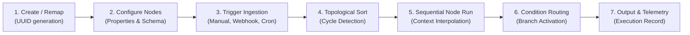
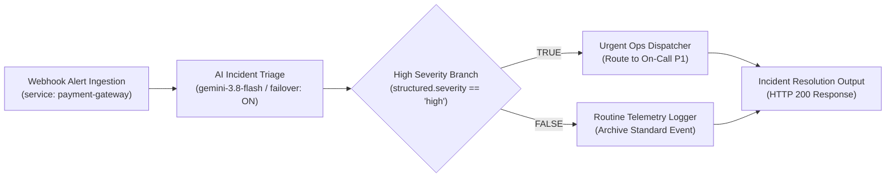

# FlowForge AI

> **Intelligent Fullstack Workflow Automation & Multi-Provider AI Orchestration Platform**  
> Built with React 19, Node.js 24 LTS, Express, MongoDB Atlas, and React Flow.

[](https://flowforge-ai-ten.vercel.app)
[](https://flowforge-ai-api-hj63.onrender.com/api/health)
[](https://www.mongodb.com/atlas)
[](https://nodejs.org)
[](https://react.dev)
[](https://opensource.org/licenses/MIT)

---

## 📑 Table of Contents
1. [Project Overview & Genuine Problem Statement](#project-overview-genuine-problem-statement)
2. [System Architecture](#system-architecture)
3. [Workflow Execution Lifecycle](#workflow-execution-lifecycle)
4. [Verified Feature Matrix](#verified-feature-matrix)
5. [Core Engineering Features](#core-engineering-features)
   - [Visual Directed Acyclic Graph (DAG) Canvas](#1-visual-directed-acyclic-graph-dag-canvas)
   - [Multi-Provider AI Failover Architecture](#2-multi-provider-ai-failover-architecture)
   - [Visual Failover Cascade Viewer & 4-Tab Node Inspector](#3-visual-failover-cascade-viewer-4-tab-node-inspector)
   - [Deterministic Execution & Selective Branch Skipping](#4-deterministic-execution-selective-branch-skipping)
   - [Safe Condition Evaluator Service](#5-safe-condition-evaluator-service)
   - [Network Security & SSRF Defense-in-Depth](#6-network-security-ssrf-defense-in-depth)
   - [Trigger Subsystems: Webhooks & Scheduling](#7-trigger-subsystems-webhooks-scheduling)
6. [Technology Stack](#technology-stack)
7. [Flagship Interview Demo: AI Incident Triage & Smart Recovery](#flagship-interview-demo-ai-incident-triage-smart-recovery)
8. [Complete API Reference](#complete-api-reference)
9. [Environment Variables](#environment-variables)
10. [Local Installation & Setup](#local-installation-setup)
11. [Monorepo Package Scripts](#monorepo-package-scripts)
12. [Deployment Overview: Vercel, Render & MongoDB Atlas](#deployment-overview-vercel-render-mongodb-atlas)
13. [Automated Testing & Verification Suite](#automated-testing-verification-suite)
14. [Security Considerations & Honest Disclosures](#security-considerations-honest-disclosures)
15. [Resume Project Description](#resume-project-description)
16. [License & Documentation](#license-documentation)

---

## 📌 Project Overview & Genuine Problem Statement

Modern engineering teams rely heavily on visual automation platforms for incident triage, telemetry routing, and data transformation. However, typical workflow systems suffer from three critical architectural vulnerabilities:
1. **Fragile Single-Provider AI Couplings:** When a primary LLM provider deprecates a model ID (HTTP 404), encounters service outages (HTTP 503), or exhausts quota limits (HTTP 429), standard automation pipelines fail catastrophically with no automatic fallback.
2. **Opaque Runtime Telemetry:** Debugging multi-step pipelines is notoriously difficult when systems only report binary "Passed" or "Failed" states without millisecond-accurate step-by-step durations, input/output traces, or provider attempt telemetry.
3. **Security Vulnerabilities in Dynamic Evaluation:** Many automation tools rely on unsafe JavaScript `eval()` or `new Function()` to parse conditional expressions, exposing backends to remote code execution and prototype pollution attacks.

**FlowForge AI** solves these challenges by combining:
- A **deterministic DAG execution engine** (Kahn's topological sort algorithm) with cycle detection, selective branch skipping, and diamond dependency convergence.
- A **multi-provider AI failover cascade** (Google Gemini `gemini-3.8-flash` &rarr; Groq `openai/gpt-oss-20b` &rarr; OpenAI `gpt-4o-mini` &rarr; Mistral AI `mistral-small-latest`) operating within a single monotonic timeout budget with exponential backoff and transparent legacy model normalization.
- A **Visual Failover Cascade Viewer & 4-Tab Node Inspector** providing transparent, step-by-step attempt observability, discrete status pills, and sanitized error diagnostics.
- A **safe condition evaluator** supporting 15 canonical comparison operators (with 29 token aliases) with strict prototype pollution guards and zero `eval()`.
- **Defense-in-depth network security** featuring private IP CIDR rejection, DNS rebinding protection, request redirect re-validation, and multi-tenant IDOR guards.

---

## 🏗️ System Architecture



---

## 🔄 Workflow Execution Lifecycle

Every workflow execution in FlowForge AI follows a deterministic, 7-stage lifecycle:



1. **Workflow Creation & Blueprints:** Workflows are created either on the blank drag-and-drop canvas or instantiated with one click from built-in blueprints. Duplications and template instances automatically remap all node and edge UUIDs to maintain isolated topologies.
2. **Node Configuration:** Each node is configured via the contextual Properties Panel. Prompts and parameters support upstream template interpolation using standard `{{ variable }}` syntax (e.g. `{{ trigger.payload.service }}`).
3. **Execution Ingestion:** Pipelines are triggered manually from the canvas, via incoming HTTP Webhook (`/api/workflows/webhook/:token`), via scheduled cron interval, or via rerun of a past execution.
4. **Topological Graph Validation:** Kahn's algorithm validates acyclicity. If a cycle or disconnected edge is detected, execution halts immediately with actionable graph diagnostics.
5. **Sequential Node Execution & Context Interpolation:** Nodes execute in deterministic topological order. Upstream outputs are aggregated into a prototype-safe resolution context.
6. **Condition Evaluation & Selective Branch Skipping:** Condition nodes evaluate the configured field against comparison operators. The matching branch handle (`true` or `false`) is activated; nodes on unselected branches are marked `skipped` (`0ms`), and their downstream edges are deactivated.
7. **State Persistence & Telemetry Collection:** Output nodes aggregate final payload data. The execution engine records full step-by-step inputs, outputs, durations, error traces, and AI attempt logs in MongoDB Atlas.

---

## 📊 Verified Feature Matrix

| Capability | Implementation Status | Evidence / Verification Method |
| :--- | :---: | :--- |
| **Visual DAG Canvas** | **Implemented & Verified** | Live interactive `@xyflow/react` 12 canvas, port snapping, node inspector |
| **Topological Execution Engine** | **Implemented & Verified** | Kahn's algorithm, cycle rejection, diamond DAG convergence verified via offline tests |
| **Multi-Provider AI Failover** | **Implemented & Verified** | 4-provider cascade (Gemini &rarr; Groq &rarr; OpenAI &rarr; Mistral) with monotonic timeout budget |
| **Default Gemini 3.8 Flash** | **Implemented & Verified** | Updated defaults across engine, templates, and UI; offline verified with Google v1beta schema |
| **Legacy Model Normalization** | **Implemented & Verified** | `resolveGeminiModel` automatically upgrades deprecated `gemini-2.5-flash` at runtime |
| **Direct Groq LPU Inference** | **Implemented & Verified** | Verified live via Groq API (`openai/gpt-oss-20b`, ~415ms); dedicated status badge in UI |
| **Safe Condition Evaluator** | **Implemented & Verified** | 15 canonical comparison operators (29 token aliases), prototype pollution blocked (`__proto__`, `constructor`), zero `eval()` |
| **Dynamic Action Transformations** | **Implemented & Verified** | JSON transformation via `interpolateObject`, field allowlist extraction, passthrough mode |
| **Execution History & Rerun** | **Implemented & Verified** | Rerun preserves original trigger payload and records rerun lineage (`rerunFrom`) |
| **Failed Execution Purge & Deletion** | **Implemented & Verified** | `DELETE /api/executions/:id` and `POST /api/executions/purge-failed` with IDOR isolation |
| **Trace JSON Export** | **Implemented & Verified** | Redacted client-side JSON export of full execution traces |
| **Network SSRF Protection** | **Implemented & Verified** | Private CIDR blocking (10.x, 192.168.x, 172.16.x, 127.x, 169.254.x), DNS rebinding guards |
| **Deterministic Demo Fixtures** | **Implemented & Verified** | Non-billable simulated fixtures (`high-severity`, `low-severity`, `failover-recovery`) for $0 demos |
| *External Slack/Discord Action Connectors* | *Planned Roadmap* | Pre-configured webhook connector presets for Slack and Discord |
| *Asynchronous Worker Queue (BullMQ)* | *Planned Roadmap* | Decoupling long-running execution pipelines into background Redis queues |
| *Distributed Scheduler (Redlock)* | *Planned Roadmap* | Distributed cron locking for multi-instance horizontal scaling |
| *httpOnly Cookie Session Auth* | *Planned Roadmap* | Enhanced defense-in-depth cookie migration with refresh token rotation |

---

## ✨ Core Engineering Features

### 1. Visual Directed Acyclic Graph (DAG) Canvas
- **React Flow Canvas (`@xyflow/react` 12):** Drag-and-drop workflow canvas with custom styled nodes, port snapping, contextual properties inspector, and edge connection validation.
- **6 Supported Node Types:**
  - **Webhook Trigger Node:** Ingests external HTTP events or manual JSON payloads.
  - **AI Processing Node:** Dispatches prompt templates to LLMs with upstream variable interpolation (`{{trigger.payload.service}}`) and structured JSON enforcement.
  - **Condition Node:** Evaluates incoming payload attributes and routes execution across dedicated `TRUE` and `FALSE` handles.
  - **Action Node:** Deterministic data passthrough, JSON template reshaping, and field filtering.
  - **API Request Node:** Dispatches outbound HTTP/HTTPS requests with SSRF guards.
  - **Return Output Node:** Commits final pipeline state and aggregates upstream trace outputs.

### 2. Multi-Provider AI Failover Architecture
- **Cascade Priority:** Google Gemini (`gemini-3.8-flash`) &rarr; Groq (`openai/gpt-oss-20b`) &rarr; OpenAI (`gpt-4o-mini`) &rarr; Mistral AI (`mistral-small-latest`).
- **Explicit Opt-In:** Failover is configured per AI node via `enableFailover: true`. Standard workflows retain single-provider execution.
- **Monotonic Global Timeout Budget:** A single timeout deadline (default: 15,000 ms) governs all candidate attempts. Each attempt subtracts elapsed time; no attempt can overrun the remaining global budget.
- **Error Classification:**
  - *Cascadeable:* Upstream model deprecation (HTTP 404), rate limit exhaustion (HTTP 429), service unavailability (HTTP 502/503/504).
  - *Fatal (Halt Immediately):* Authentication failure (HTTP 401/403), malformed request (HTTP 400), content safety filter blocks.
- **Graceful Key Skipping:** If an optional fallback API key is omitted on the server, the provider is cleanly skipped without throwing an exception or failing the workflow.

#### 🛡️ AI Verification & Testing Disclosures (Honest Production Audit)
- **Live-Verified Provider:** Standalone inference for Groq (`openai/gpt-oss-20b`) has been verified against Groq's official API endpoint, confirming sub-second generation (~415ms) and structured JSON parsing.
- **Mock-Verified Failover Suite:** The multi-provider failover cascade (Gemini 503 transient recovery &rarr; Groq, Gemini 404 model retirement &rarr; Groq, unconfigured key skipping, total cascade failure secret scrubbing, and 401 permanent error halts) has been verified via 16 dedicated offline tests (`scratch/test_gemini_model_configuration.mjs`) using guarded mock envelopes ($0 cost).
- **Gemini Status Disclosure:** Google Gemini `gemini-3.8-flash` request payloads, REST endpoints, and backward-compatible model normalizations are verified via offline tests conforming strictly to Google's official v1beta API schema.

### 3. Visual Failover Cascade Viewer & 4-Tab Node Inspector
- **4-Tab Node Inspector:** Embedded in `ExecutionResultModal.jsx` and historical trace drawers with dedicated tabs:
  1. *Output:* Final parsed JSON or text generated by the node.
  2. *Input:* Aggregated parent data passed into the node.
  3. *Telemetry:* Millisecond duration, token usage counts, and execution timestamps.
  4. *AI Cascade:* Step-by-step attempt cards showing candidate providers, latencies, and HTTP status codes.
- **Discrete Operational Badges:** Visualizes `Direct LPU Execution (Groq)` (Gold), `Primary Succeeded (Fallback Not Needed)` (Emerald), `Failover Resolved` (Gold), `Cascade Exhausted` (Ruby), and `Single-Provider Mode` (Muted Warmgray).
- **Zero Secret Leaks:** Scrubbing pipeline redacts Bearer tokens, query parameter API keys (`key=[REDACTED]`), and local file paths before rendering in diagnostic error callouts.

### 4. Deterministic Execution & Selective Branch Skipping
- **Kahn's Topological Sort:** Validates graph acyclicity prior to execution, detecting circular dependencies immediately.
- **Branch Reachability:** Deactivates unselected conditional branches. Nodes on inactive branches are marked `status: 'skipped'` (`0ms` duration), preventing wasted compute.
- **Diamond DAG Convergence:** Re-joining DAG paths execute shared downstream nodes **exactly once** when reachable via the active path.

### 5. Safe Condition Evaluator Service
- **15 Canonical Operators (29 Token Aliases):** Resolves standard comparison symbols and aliases (`==`, `===`, `!=`, `!==`, `>`, `>=`, `<`, `<=`, `eq`, `neq`, `gt`, `gte`, `lt`, `lte`) to 15 canonical evaluation routines: `equals`, `strict_equals`, `not_equals`, `greater_than`, `greater_than_or_equal`, `less_than`, `less_than_or_equal`, `contains`, `not_contains`, `starts_with`, `ends_with`, `is_empty`, `is_not_empty`, `is_true`, and `is_false`.
- **Zero `eval()`:** No dynamic code evaluation or string-to-code execution.
- **Prototype Pollution Prevention:** Explicitly blocks traversal into `__proto__`, `constructor`, and `prototype`.
- **Safe Path Resolution:** Supports nested dot-notation (`structured.severity`) and bracket syntax (`items[0].id`).

### 6. Network Security & SSRF Defense-in-Depth
- **CIDR Address Blocks:** Rejects IPv4 private ranges (`10.0.0.0/8`, `172.16.0.0/12`, `192.168.0.0/16`), loopback (`127.0.0.0/8`), IPv6 loopback (`::1`), and cloud metadata IP (`169.254.169.254`).
- **DNS Rebinding Protection:** Pre-resolves target hostnames via `dns.promises.lookup` to ensure domains do not resolve to internal network IPs.
- **Redirect Re-validation:** Validates target URLs upon every redirect hop (up to 5 redirects).
- **Stream Bounds:** Outbound request bodies capped at 32 KB; response bodies bounded at 512 KB to prevent memory exhaustion.

### 7. Trigger Subsystems: Webhooks & Scheduling
- **Token-Based Webhook Ingestion:** Ingests external payloads via `/api/workflows/webhook/:token` or `/api/webhooks/:token` with unguessable tokens and optional HMAC secret verification.
- **In-Memory Cron Scheduler:** Background scheduling via `node-cron` with overlap prevention, initializing active schedules on server boot.

---

## 🛠️ Technology Stack

| Layer | Technologies | Version / Notes | Core Architectural Responsibilities |
| :--- | :--- | :--- | :--- |
| **Frontend Framework** | React | 19.2.8 (Vite 8.3 bundler) | Component rendering, state synchronization, client-side routing |
| **Workflow Canvas** | `@xyflow/react` | 12.12.0 (React Flow) | Node rendering, edge wiring, interactive pan/zoom canvas, handle ports |
| **Styling & Icons** | Tailwind CSS & Lucide React | Charcoal `#0B0D0C`, Gold `#E5B45B`, Emerald `#059669` | Design token system, responsive utility classes, iconography |
| **Client HTTP & State** | Axios & React Router | Axios 1.20, React Router 7.18 | Centralized request/response interceptors, auth token injection, route guards |
| **Backend Runtime** | Node.js (ESM) | v24 LTS | Native `fetch`, `AbortController`, streaming HTTP parsers |
| **Web Server** | Express | 4.21.2 | RESTful routing, middleware orchestration, proxy trust configuration |
| **Database & ODM** | MongoDB Atlas & Mongoose | Mongoose 8.9.5 | Managed document persistence, schema constraints, indexing, transactions |
| **Security & Auth** | bcryptjs & jsonwebtoken | 10-round bcrypt salt, HMAC-SHA256 JWT | Password hashing, stateless bearer token creation and verification |
| **Rate Limiting** | express-rate-limit | MemoryStore with IPv6 normalization | DoS and brute-force mitigation on auth and execution endpoints |
| **Cron Scheduling** | node-cron | 4.6.0 | In-process cron job scheduling, timezone support, lifecycle registration |

---

## 🎯 Flagship Interview Demo: AI Incident Triage & Smart Recovery

For a 2–3 minute technical interview walkthrough, demonstrate the **AI Incident Triage & Smart Recovery** blueprint:



### Verified Demo Fixture Scenarios ($0 Cost)
FlowForge AI includes built-in deterministic demo fixtures for technical interviews, allowing full pipeline demonstrations without requiring live billing:

1. **Scenario A: High Severity Incident (`TRUE` Branch)**
   - **Input:** `{ service: "payment-gateway", latencyP99Ms: 2450, errorRatePercent: 14.8 }`
   - **AI Node Output:** `{ severity: "high", reason: "Database pool exhausted", recommendedAction: "Trigger PagerDuty P1" }`
   - **Condition Evaluation:** `structured.severity` equals `'high'` &rarr; **`TRUE`**
   - **Execution Path:** `Urgent Ops Dispatcher` executes; `Routine Telemetry Logger` is marked **Skipped (`0ms`)**.

2. **Scenario B: Low Severity Routine Telemetry (`FALSE` Branch)**
   - **Input:** `{ service: "auth-service", latencyP99Ms: 120, errorRatePercent: 0.1 }`
   - **AI Node Output:** `{ severity: "low", reason: "Nominal operational telemetry", recommendedAction: "Archive to routine ledger" }`
   - **Condition Evaluation:** `structured.severity` equals `'high'` &rarr; **`FALSE`**
   - **Execution Path:** `Routine Telemetry Logger` executes; `Urgent Ops Dispatcher` is marked **Skipped (`0ms`)**.

3. **Scenario C: Multi-Provider Failover Recovery**
   - **Primary Attempt:** Gemini encounters HTTP 503 or model retirement HTTP 404 &rarr; Failover initiated.
   - **Fallback Attempt:** Groq LPU recovers with HTTP 200 in ~312ms.
   - **Telemetry:** Execution trace displays candidate attempts, durations, and dynamic recovery path badge `gemini ➔ groq (openai/gpt-oss-20b)`.

---

## 📋 Complete API Reference

### Authentication Endpoints (`/api/auth`)
| Method | Endpoint | Access | Description |
| :--- | :--- | :--- | :--- |
| `POST` | `/api/auth/register` | Public (Rate Limited) | Creates user account, returns JWT token |
| `POST` | `/api/auth/login` | Public (Rate Limited) | Authenticates credentials, returns JWT token |
| `GET` | `/api/auth/me` | Private (JWT) | Returns authenticated user profile |
| `PUT` | `/api/auth/profile` | Private (JWT) | Updates user profile (name, password) |

### Workflow Management Endpoints (`/api/workflows`)
| Method | Endpoint | Access | Description |
| :--- | :--- | :--- | :--- |
| `POST` | `/api/workflows` | Private (JWT) | Creates new workflow document |
| `GET` | `/api/workflows` | Private (JWT) | Lists authenticated user's workflows |
| `GET` | `/api/workflows/:id` | Private (JWT) | Fetches workflow definition by ID (IDOR protected) |
| `PUT` | `/api/workflows/:id` | Private (JWT) | Updates workflow nodes and edges |
| `DELETE`| `/api/workflows/:id` | Private (JWT) | Deletes workflow document |
| `POST` | `/api/workflows/:id/duplicate` | Private (JWT) | Duplicates workflow as a new document with remapped IDs |
| `GET` | `/api/workflows/templates` | Private (JWT) | Lists available workflow blueprints and catalog templates |
| `POST` | `/api/workflows/from-template` | Private (JWT) | Instantiates a new workflow from a catalog blueprint |
| `GET` | `/api/workflows/:id/triggers` | Private (JWT) | Fetches schedule and webhook configurations |
| `PUT` | `/api/workflows/:id/schedule` | Private (JWT) | Updates workflow cron schedule |
| `PUT` | `/api/workflows/:id/webhook` | Private (JWT) | Generates/updates webhook token and HMAC secret |
| `POST` | `/api/workflows/:id/execute` | Private (Rate Limited) | Executes workflow synchronously and records trace |
| `GET` | `/api/workflows/:id/executions`| Private (JWT) | Lists run history for specific workflow |

### Webhook Ingestion Endpoints
| Method | Endpoint | Access | Description |
| :--- | :--- | :--- | :--- |
| `POST` | `/api/workflows/webhook/:token` | Public (Rate Limited) | Ingests payload and triggers workflow execution |
| `POST` | `/api/webhooks/:token` | Public (Rate Limited) | Public alias for webhook ingestion |

### Execution Telemetry Endpoints (`/api/executions`)
| Method | Endpoint | Access | Description |
| :--- | :--- | :--- | :--- |
| `GET` | `/api/executions` | Private (JWT) | Paginated list of user execution traces with status & trigger filter |
| `GET` | `/api/executions/stats` | Private (JWT) | Aggregated stats (total, succeeded, failed, success rate) |
| `GET` | `/api/executions/:id` | Private (JWT) | Detailed trace including node-level inputs, outputs, and failoverLog |
| `POST` | `/api/executions/:id/rerun` | Private (Rate Limited) | Reruns execution preserving original trigger payload and lineage |
| `DELETE`| `/api/executions/:id` | Private (JWT) | Deletes a single execution trace (owner-only) |
| `POST` | `/api/executions/purge-failed` | Private (JWT) | Purges all failed execution records for authenticated user |

### Health Probes (`/api/health`)
| Method | Endpoint | Access | Description |
| :--- | :--- | :--- | :--- |
| `GET` | `/api/health` | Public | Primary health & database connection probe (HTTP 503 if disconnected) |
| `GET` | `/api/health/liveness` | Public | Lightweight process liveness probe |
| `GET` | `/api/health/readiness`| Public | Database readiness probe |

---

## ⚙️ Environment Variables

### Backend Configuration (`server/.env`)
Use `server/.env.example` as a template:

```env
# Server Configuration
PORT=5000
NODE_ENV=development

# Database Connection
MONGODB_URI=your_mongodb_connection_string_here

# Authentication Security
JWT_SECRET=your_secure_random_jwt_secret_key_here
JWT_EXPIRES_IN=7d

# CORS Configuration (comma-separated allowed origins)
CLIENT_ORIGIN=http://localhost:5173,https://flowforge-ai-ten.vercel.app

# Rate Limiting
AUTH_RATE_LIMIT_WINDOW_MS=900000
AUTH_RATE_LIMIT_MAX=20
EXECUTION_RATE_LIMIT_WINDOW_MS=60000
EXECUTION_RATE_LIMIT_MAX=30

# AI Provider Credentials (Server-Side Only - Never Exposed to Client)
AI_PROVIDER=gemini
GEMINI_API_KEY=your_gemini_api_key_here
GROQ_API_KEY=your_groq_api_key_here
OPENAI_API_KEY=your_openai_api_key_here
MISTRAL_API_KEY=your_mistral_api_key_here

# Default AI Model Settings
GEMINI_DEFAULT_MODEL=gemini-3.8-flash
GROQ_DEFAULT_MODEL=openai/gpt-oss-20b
OPENAI_DEFAULT_MODEL=gpt-4o-mini
MISTRAL_DEFAULT_MODEL=mistral-small-latest
```

| Variable Name | Required | Default / Example Purpose |
| :--- | :---: | :--- |
| `PORT` | Optional | Port for Express server (default: `5000`) |
| `NODE_ENV` | Optional | Runtime mode: `development` or `production` |
| `MONGODB_URI` | **Required** | MongoDB connection string (Atlas or local) |
| `JWT_SECRET` | **Required** | High-entropy secret key for signing auth tokens |
| `JWT_EXPIRES_IN` | Optional | JWT lifetime (e.g. `1d`, `7d`) |
| `CLIENT_ORIGIN` | **Required in Prod** | Comma-separated allowlist of origins permitted by CORS |
| `AUTH_RATE_LIMIT_WINDOW_MS` | Optional | Window in ms for authentication rate limiting |
| `AUTH_RATE_LIMIT_MAX` | Optional | Max auth requests permitted per window |
| `EXECUTION_RATE_LIMIT_WINDOW_MS`| Optional | Window in ms for execution rate limiting |
| `EXECUTION_RATE_LIMIT_MAX` | Optional | Max execution requests permitted per window |
| `AI_PROVIDER` | Optional | Default primary provider (`gemini`) |
| `GEMINI_DEFAULT_MODEL` | Optional | Default Gemini model (`gemini-3.8-flash`) |
| `GEMINI_API_KEY` | Optional | API key for Google Gemini inference |
| `GROQ_API_KEY` | Optional | API key for Groq LPU inference |
| `OPENAI_API_KEY` | Optional | API key for OpenAI inference |
| `MISTRAL_API_KEY` | Optional | API key for Mistral AI inference |

*Note: AI provider API keys are strictly server-side credentials and are never sent to or accessible by the browser client.*

### Frontend Configuration (`client/.env`)
Use `client/.env.example` as a template:

```env
# Public Backend API Base URL (inlined by Vite at build time)
VITE_API_BASE_URL=http://localhost:5000/api
```

| Variable Name | Required | Description |
| :--- | :---: | :--- |
| `VITE_API_BASE_URL` | Optional | Public URL of backend API (e.g. `http://localhost:5000/api` or production endpoint) |

---

## 🚀 Local Installation & Setup

### Prerequisites
- **Node.js**: `>= 20.0.0` (Node.js 24 LTS recommended)
- **npm**: `>= 10.0.0`
- **MongoDB**: Active MongoDB Atlas cluster or local MongoDB instance

### Step 1: Clone Repository
```bash
git clone https://github.com/DivyanshuG23/flowforge-ai.git
cd flowforge-ai
```

### Step 2: Setup & Start Backend Server
```bash
cd server
npm install
cp .env.example .env
# Configure MONGODB_URI and JWT_SECRET in server/.env
npm run dev
```
*Backend API will start at:* `http://localhost:5000`  
*Verify health check:* `http://localhost:5000/api/health`

### Step 3: Setup & Start Frontend Client
```bash
# In a separate terminal:
cd client
npm install
cp .env.example .env
npm run dev
```
*Frontend will start at:* `http://localhost:5173`

---

## 📦 Monorepo Package Scripts

| Directory | Command | Description |
| :--- | :--- | :--- |
| `server/` | `npm start` | Runs production backend server (`node server.js`) |
| `server/` | `npm run dev` | Runs backend in development mode with `nodemon` |
| `server/` | `npm test` | Runs offline test readiness harness |
| `client/` | `npm run dev` | Starts Vite development server at `localhost:5173` |
| `client/` | `npm run build` | Compiles production assets into `client/dist/` |
| `client/` | `npm run preview`| Locally serves production build bundle |
| `client/` | `npm run lint` | Fast static code analysis via `oxlint` |

---

## 🌐 Deployment Overview: Vercel, Render & MongoDB Atlas

FlowForge AI is deployed using a decoupled, production-verified cloud architecture:

### 1. Frontend: Vercel SPA
- **Hosting URL:** `https://flowforge-ai-ten.vercel.app`
- **Configuration:** `client/vercel.json` provides standard Single Page Application rewrite rules mapping `/(.*)` to `/index.html`.
- **Environment:** `VITE_API_BASE_URL` is configured to point directly to Render backend (`https://flowforge-ai-api-hj63.onrender.com/api`).
- **CI/CD:** Pushes to `main` trigger automated Vite builds and global edge CDN deployment.

### 2. Backend: Render Web Service
- **Hosting URL:** `https://flowforge-ai-api-hj63.onrender.com`
- **Configuration:** Node.js Web Service running `npm start`. Configured with `app.set('trust proxy', 1)` to correctly inspect client IP addresses behind Cloudflare/Render reverse proxies.
- **CORS Allowlist:** `CLIENT_ORIGIN` is configured to restrict browser cross-origin requests strictly to `https://flowforge-ai-ten.vercel.app`.
- **Health Verification:** Public probe available at `/api/health`, returning JSON readiness status and MongoDB connection state.

### 3. Database: MongoDB Atlas
- **Storage:** Managed MongoDB Atlas replica set.
- **Connection Security:** Mongoose connection string configured with secure TLS/SSL, DNS SRV resolution fallback, and IP access allowlisting.

---

## 🧪 Automated Testing & Verification Suite

FlowForge AI includes an automated offline test harness covering security boundaries, graph execution semantics, multi-provider failover cascades, and data sanitization.

### Execution Commands
```bash
# Run Gemini model configuration & error handling policy suite (16 tests):
node scratch/test_gemini_model_configuration.mjs

# Run backend AI executor service comprehensive suite (82 tests):
node scratch/test_ai_executor.mjs

# Run dynamic template interpolation & action node suite (15 tests):
node scratch/test_template_interpolation_and_action_nodes.mjs

# Run workflow duplication & ID remapping verification (7 tests):
node scratch/test_workflow_duplication_remapping.mjs

# Run security deep verification & SSRF protection suite (22 tests):
node scratch/test_dynamic_data_flow_and_security_deep_verification.mjs

# Run AI fallback visibility & Groq badge telemetry suite (9 tests):
node scratch/test_ai_fallback_visibility.mjs

# Run documentation & Mermaid syntax verification (17 checks):
node scratch/test_documentation_verification.mjs

# Run client production build verification:
npm --prefix client run build
```

### Verified Test Results Summary
| Test Suite | Focus Area | Verified Scope | Result |
| :--- | :--- | :---: | :---: |
| `test_gemini_model_configuration.mjs` | Default `gemini-3.8-flash`, legacy normalization, Groq isolation, 404/401/429/503 policies | 16 Tests | **16 / 16 PASSED** |
| `test_ai_executor.mjs` | SSRF prevention, URL sanitization, prompt interpolation, token telemetry, error handling | 82 Tests | **82 / 82 PASSED** |
| `test_template_interpolation_and_action_nodes.mjs` | Variable resolution, type preservation, action transform/filter/passthrough, prototype guards | 15 Tests | **15 / 15 PASSED** |
| `test_workflow_duplication_remapping.mjs` | Node/edge UUID remapping, document cloning, cross-user IDOR isolation | 7 Tests | **7 / 7 PASSED** |
| `test_dynamic_data_flow_and_security_deep_verification.mjs` | SSRF CIDR filters (10.x, 192.168.x, 169.254.x), prototype pollution, secondary injection | 22 Tests | **22 / 22 PASSED** |
| `test_ai_fallback_visibility.mjs` | Groq direct badge, fallback recovery, skipped provider, secret redaction | 9 Tests | **9 / 9 PASSED** |
| `test_documentation_verification.mjs` | Section completeness, Mermaid syntax, relative link integrity, secret placeholder check | 17 Checks | **17 / 17 PASSED** |
| `client: npm run build` | Vite 8.3 production bundling, CSS minification, syntax validation | 2,145 Modules | **BUILT IN 1.35s (0 Errors)** |

---

## 🔒 Security Considerations & Honest Disclosures

1. **Ephemeral Hosting & Cold Starts:** On free-tier cloud hosting (e.g. Render), backend instances spin down after inactivity. The initial request may take 30–50 seconds to wake the service. Setting up a free external ping monitor (e.g. Cron-Job.org or BetterStack) targeting `/api/health` every 10 minutes keeps the container warm.
2. **Synchronous Execution Pipeline Timeout Risk:** Workflows execute synchronously within the Express HTTP request cycle. Complex multi-step pipelines with multiple retries can approach cloud gateway limits (15–30s on Render/Vercel). Migrating long-running pipelines to an asynchronous background worker queue (e.g. BullMQ / Redis) is planned for enterprise scaling.
3. **In-Memory Rate Limiting:** `express-rate-limit` tracks IP counters in Node.js process memory with IPv6 subnet normalization. For distributed multi-instance clusters, configuring a shared Redis store via `rate-limit-redis` is recommended.
4. **In-Memory Scheduler:** Scheduled triggers (`node-cron`) run in-process. In horizontally scaled container environments, duplicate execution prevention requires a distributed lock (e.g. Redis Redlock).
5. **JWT Storage:** Auth tokens are stored in browser `localStorage`. For environments requiring strict XSS immunity, migrating to `httpOnly`, `SameSite=Strict` cookies with CSRF tokens is recommended.
6. **Live Fallback Credentials:** Multi-provider fallback execution requires server environment keys (e.g. `GROQ_API_KEY`). When optional fallback keys are absent, the executor cleanly skips unconfigured providers without crashing and reports the primary result in the cascade timeline.

---

## 💼 Resume Project Description

```markdown
**FlowForge AI — Fullstack Visual Workflow Automation & AI Orchestration Platform**
*Node.js 24 LTS, Express, MongoDB Atlas, React 19, React Flow, Tailwind CSS, Google Gemini, Groq, OpenAI*
• Engineered a deterministic DAG execution engine featuring Kahn's topological sort algorithm, cycle detection, selective branch skipping, and diamond dependency convergence.
• Implemented a resilient 4-provider AI failover cascade (Google Gemini → Groq → OpenAI → Mistral AI) with a monotonic timeout budget, exponential backoff with jitter, and automatic key-skipping.
• Built an interactive React Flow canvas with custom nodes, contextual properties inspector, and a Visual Failover Cascade Viewer rendering millisecond-level step telemetry and scrubbed diagnostics.
• Fortified platform security with SSRF prevention (private CIDR blocks, DNS rebinding guards, redirect re-validation), prototype-pollution-free condition evaluation (15 canonical operators / 29 aliases), and multi-tenant IDOR defense.
```

---

## 📄 License & Documentation

- **Architecture Deep-Dive:** Read [`docs/ARCHITECTURE.md`](docs/ARCHITECTURE.md) for module specifications, execution flow sequence diagrams, and security boundary implementations.
- **License:** Distributed under the [MIT License](https://opensource.org/licenses/MIT).
