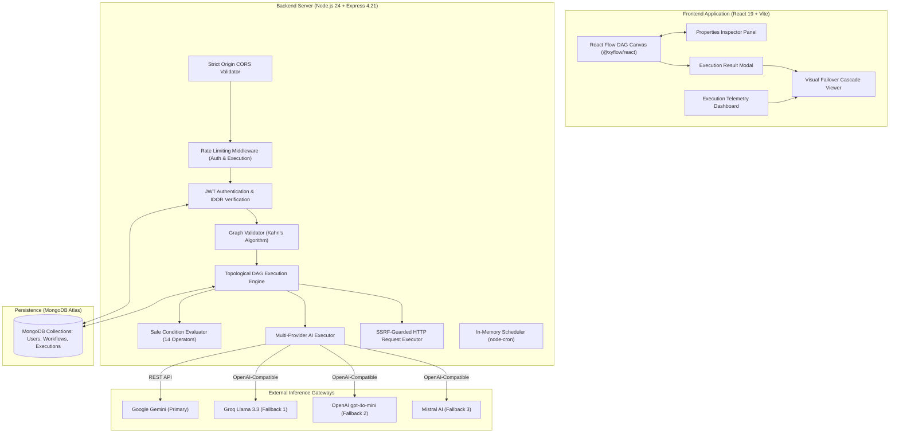

# FlowForge AI

> **Intelligent Fullstack Workflow Automation & Multi-Provider AI Orchestration Platform**  
> Built with React 19, Node.js 24, Express, MongoDB Atlas, and React Flow.

[](https://flowforge-ai-ten.vercel.app)
[](https://flowforge-ai-api-hj63.onrender.com/api/health)
[](https://www.mongodb.com/atlas)
[](https://nodejs.org)
[](https://react.dev)

---

## 📌 Project Overview & Genuine Problem Statement

Modern engineering teams rely heavily on visual automation tools for incident triage, support routing, and data ETL. However, existing workflow systems face three major architectural flaws:
1. **Fragile Single-Provider AI Couplings:** When a primary LLM provider deprecates a model ID (such as an upstream HTTP 404) or hits an API rate limit (HTTP 429), standard automation pipelines crash completely without fallback recovery.
2. **Opaque Runtime State:** Debugging multi-step pipelines is notoriously difficult when systems only report binary "Passed" or "Failed" states without millisecond-accurate step-by-step durations, input/output traces, or provider attempt telemetry.
3. **Security Vulnerabilities in Dynamic Evaluation:** Many automation tools use unsafe JavaScript `eval()` or `new Function()` to parse conditional expressions, exposing backends to remote code execution and prototype pollution attacks.

**FlowForge AI** solves these challenges by combining:
- A **deterministic DAG execution engine** (Kahn's topological sort algorithm) with branch reachability and diamond DAG convergence.
- A **multi-provider AI failover cascade** (Google Gemini &rarr; Groq &rarr; OpenAI &rarr; Mistral AI) operating within a single monotonic timeout budget.
- A **Visual Failover Cascade Viewer** providing transparent, step-by-step attempt observability and sanitized error reporting.
- A **safe condition evaluator** supporting 14 comparison operators with strict prototype pollution guards and zero `eval()`.
- **Defense-in-depth security** featuring private IP CIDR rejection, DNS rebinding prevention, and multi-tenant IDOR guards.

---

## 🏗️ System Architecture



---

## ✨ Core Engineering Features

### 1. Visual Directed Acyclic Graph (DAG) Canvas
- **React Flow Canvas (`@xyflow/react` 12):** Drag-and-drop workflow canvas with custom styled nodes, port snapping, contextual properties inspector, and edge connection validation.
- **6 Supported Node Types:**
  - **Webhook Trigger Node:** Ingests external HTTP events or manual JSON payloads.
  - **AI Processing Node:** Dispatches prompt templates to LLMs with upstream variable interpolation and structured JSON enforcement.
  - **Condition Node:** Evaluates incoming payload attributes and routes execution across dedicated `TRUE` and `FALSE` handles.
  - **Action Node:** Deterministic data passthrough and transformation.
  - **API Request Node:** Dispatches outbound HTTP/HTTPS requests with SSRF guards.
  - **Return Output Node:** Commits final pipeline state and aggregates upstream trace outputs.

### 2. Multi-Provider AI Failover Architecture
- **Cascade Priority:** Google Gemini &rarr; Groq (`llama-3.3-70b-versatile`) &rarr; OpenAI (`gpt-4o-mini`) &rarr; Mistral AI (`mistral-small-latest`).
- **Explicit Opt-In:** Failover is configured per AI node via `enableFailover: true`. Default workflows retain single-provider behavior.
- **Monotonic Global Timeout Budget:** A single timeout deadline (default: 15,000 ms) governs all candidate attempts. Each attempt subtracts elapsed time; no attempt can overrun the remaining global budget.
- **Error Classification:**
  - *Cascadeable:* Upstream model deprecation (HTTP 404), rate limit exhaustion (HTTP 429), service unavailability (HTTP 502/503/504).
  - *Fatal (Halt Immediately):* Authentication failure (HTTP 401/403), malformed request (HTTP 400), content safety filter blocks.
- **Graceful Key Skipping:** If an optional fallback API key is omitted on the server, the provider is cleanly skipped without throwing an exception or failing the workflow.

### 3. Visual Failover Cascade Viewer
- **Polished Timeline Card:** Integrated directly into `ExecutionResultModal.jsx` and historical `Executions.jsx` trace drawers.
- **Discrete Operational Badges:** Visualizes `Success • Recovered` (Emerald), `Model Unavailable (HTTP 404)` (Gold/Ruby), `Skipped • Unconfigured Key` (Warmgray), `Rate Limit (HTTP 429)` (Gold), and `Auth Error` (Ruby).
- **Canvas Status Badges:** Updates node subtitles to display dynamic recovery paths (e.g. `gemini ➔ groq (llama-3.3-70b-versatile)`) with a gold sparkle `Failover OK` runtime badge.
- **Zero Secret Leaks:** Scrubbing pipeline redacts Bearer tokens, query parameter API keys (`key=[REDACTED]`), and local file paths before rendering in diagnostic error callouts.

### 4. Deterministic Execution & Selective Branch Skipping
- **Kahn's Topological Sort:** Validates graph acyclicity prior to execution, detecting circular dependencies immediately.
- **Branch Reachability:** Deactivates unselected conditional branches. Nodes on inactive branches are marked `status: 'skipped'` (`0ms` duration), preventing wasted compute.
- **Diamond DAG Convergence:** Re-joining DAG paths execute shared downstream nodes **exactly once** when reachable via the active path.

### 5. Safe Condition Evaluator Service
- **14 Built-in Operators:** `equals`, `strict_equals`, `not_equals`, `greater_than`, `greater_than_or_equal`, `less_than`, `less_than_or_equal`, `contains`, `not_contains`, `starts_with`, `ends_with`, `is_empty`, `is_not_empty`, `is_true`, `is_false`.
- **Zero `eval()`:** No dynamic code evaluation or string-to-code execution.
- **Prototype Pollution Prevention:** Explicitly blocks traversal into `__proto__`, `constructor`, and `prototype`.
- **Safe Path Resolution:** Supports nested dot-notation (`structured.severity`) and bracket syntax (`items[0].id`).

### 6. Network Security & SSRF Defense-in-Depth
- **CIDR Address Blocks:** Rejects IPv4 private ranges (`10.0.0.0/8`, `172.16.0.0/12`, `192.168.0.0/16`), loopback (`127.0.0.0/8`), and cloud metadata IP (`169.254.169.254`).
- **DNS Rebinding Protection:** Pre-resolves target hostnames via `dns.promises.lookup` to ensure domains do not resolve to internal network IPs.
- **Redirect Re-validation:** Validates target URLs upon every redirect hop (up to 5 redirects).
- **Stream Bounds:** Outbound request bodies capped at 32 KB; response bodies bounded at 512 KB to prevent memory exhaustion.

### 7. Trigger Subsystems: Webhooks & Scheduling
- **Token-Based Webhook Ingestion:** Ingests external payloads via `/api/workflows/webhook/:token` or `/api/webhooks/:token` with optional HMAC secret verification.
- **In-Memory Cron Scheduler:** Background scheduling via `node-cron` with overlap prevention, initializing active schedules on server boot.

---

## 🛠️ Technology Stack

| Layer | Technologies | Version / Notes |
| :--- | :--- | :--- |
| **Frontend Framework** | React | 19.0.0 (Vite 8.3 bundler) |
| **Workflow Canvas** | `@xyflow/react` | 12.4.2 (React Flow) |
| **Styling & Icons** | Tailwind CSS & Lucide React | Luxury palette: Obsidian Charcoal, Champagne Gold, Emerald, Ruby, Ivory |
| **Routing & HTTP** | React Router & Axios | React Router 7.2, Axios 1.7 with token interceptors |
| **Backend Runtime** | Node.js (ESM) | v24 LTS (native `fetch`, `AbortController`) |
| **Web Server** | Express | 4.21.2 |
| **Database & ODM** | MongoDB Atlas & Mongoose | Mongoose 8.9.5 |
| **Security & Auth** | bcryptjs & jsonwebtoken | JWT Bearer authentication, 10-round bcrypt salt |
| **Rate Limiting** | express-rate-limit | MemoryStore, per-route IP tracking |
| **Scheduling** | node-cron | 3.0.3 |

---

## 📋 Complete API Reference

### Authentication Endpoints (`/api/auth`)
| Method | Endpoint | Access | Description |
| :--- | :--- | :--- | :--- |
| `POST` | `/api/auth/register` | Public (Rate Limited) | Creates user account, returns JWT token |
| `POST` | `/api/auth/login` | Public (Rate Limited) | Authenticates credentials, returns JWT token |
| `GET` | `/api/auth/me` | Private (JWT) | Returns authenticated user profile |
| `PUT` | `/api/auth/profile` | Private (JWT) | Updates user profile (name, password) |

### Workflow Management Endpoints (`/api/workflows`)
| Method | Endpoint | Access | Description |
| :--- | :--- | :--- | :--- |
| `POST` | `/api/workflows` | Private (JWT) | Creates new workflow document |
| `GET` | `/api/workflows` | Private (JWT) | Lists authenticated user's workflows |
| `GET` | `/api/workflows/:id` | Private (JWT) | Fetches workflow definition by ID (IDOR protected) |
| `PUT` | `/api/workflows/:id` | Private (JWT) | Updates workflow nodes and edges |
| `DELETE`| `/api/workflows/:id` | Private (JWT) | Deletes workflow document |
| `POST` | `/api/workflows/:id/duplicate` | Private (JWT) | Duplicates workflow as a new document |
| `GET` | `/api/workflows/:id/triggers` | Private (JWT) | Fetches schedule and webhook configurations |
| `PUT` | `/api/workflows/:id/schedule` | Private (JWT) | Updates workflow cron schedule |
| `PUT` | `/api/workflows/:id/webhook` | Private (JWT) | Generates/updates webhook token and HMAC secret |
| `POST` | `/api/workflows/:id/execute` | Private (Rate Limited) | Executes workflow synchronously and records trace |
| `GET` | `/api/workflows/:id/executions`| Private (JWT) | Lists run history for specific workflow |

### Webhook Ingestion Endpoints
| Method | Endpoint | Access | Description |
| :--- | :--- | :--- | :--- |
| `POST` | `/api/workflows/webhook/:token` | Public (Rate Limited) | Ingests payload and triggers workflow execution |
| `POST` | `/api/webhooks/:token` | Public (Rate Limited) | Public alias for webhook ingestion |

### Execution Telemetry Endpoints (`/api/executions`)
| Method | Endpoint | Access | Description |
| :--- | :--- | :--- | :--- |
| `GET` | `/api/executions` | Private (JWT) | Paginated list of user execution traces with status filter |
| `GET` | `/api/executions/stats` | Private (JWT) | Aggregated stats (total, succeeded, failed, success rate) |
| `GET` | `/api/executions/:id` | Private (JWT) | Detailed trace including node-level inputs, outputs, and failoverLog |

### Health Probes (`/api/health`)
| Method | Endpoint | Access | Description |
| :--- | :--- | :--- | :--- |
| `GET` | `/api/health` | Public | Primary health & database connection probe (HTTP 503 if disconnected) |
| `GET` | `/api/health/liveness` | Public | Lightweight process liveness probe |
| `GET` | `/api/health/readiness`| Public | Database readiness probe |

---

## ⚙️ Environment Variables

### Backend (`server/.env`)
Use `server/.env.example` as a template:

```env
# Server Configuration
PORT=5000
NODE_ENV=development

# Database Connection
MONGODB_URI=your_mongodb_connection_string_here

# Authentication Security
JWT_SECRET=your_secure_random_jwt_secret_key_here
JWT_EXPIRES_IN=7d

# CORS Configuration (comma-separated allowed origins)
CLIENT_ORIGIN=http://localhost:5173,https://flowforge-ai-ten.vercel.app

# Rate Limiting
AUTH_RATE_LIMIT_WINDOW_MS=900000
AUTH_RATE_LIMIT_MAX=20
EXECUTION_RATE_LIMIT_WINDOW_MS=60000
EXECUTION_RATE_LIMIT_MAX=30

# AI Provider Credentials (Server-Side Only - Never Exposed to Client)
GEMINI_API_KEY=your_gemini_api_key_here
GROQ_API_KEY=your_groq_api_key_here
OPENAI_API_KEY=your_openai_api_key_here
MISTRAL_API_KEY=your_mistral_api_key_here

# Default AI Model Settings
GEMINI_DEFAULT_MODEL=gemini-3.8-flash
GROQ_DEFAULT_MODEL=llama-3.3-70b-versatile
OPENAI_DEFAULT_MODEL=gpt-4o-mini
MISTRAL_DEFAULT_MODEL=mistral-small-latest
```

### Frontend (`client/.env`)
Use `client/.env.example` as a template:

```env
# Public Backend API Base URL (inlined by Vite at build time)
VITE_API_BASE_URL=http://localhost:5000/api
```

---

## 🚀 Local Installation & Setup

### Prerequisites
- **Node.js**: `>= 20.0.0` (Node.js 24 LTS verified)
- **npm**: `>= 10.0.0`
- **MongoDB**: Active MongoDB Atlas cluster or local MongoDB instance

### Step 1: Clone Repository
```bash
git clone https://github.com/DivyanshuG23/flowforge-ai.git
cd flowforge-ai
```

### Step 2: Setup & Start Backend Server
```bash
cd server
npm install
cp .env.example .env
# Configure MONGODB_URI and JWT_SECRET in server/.env
npm run dev
```
*Backend API will start at:* `http://localhost:5000`  
*Verify health check:* `http://localhost:5000/api/health`

### Step 3: Setup & Start Frontend Client
```bash
# In a new terminal window:
cd client
npm install
cp .env.example .env
npm run dev
```
*Frontend will start at:* `http://localhost:5173`

---

## 🧪 Automated Testing & Verification Suite

FlowForge AI includes an extensive automated test harness covering security boundaries, graph execution semantics, failover cascades, and data sanitization.

### Execution Commands
```bash
# Run unit tests for AI Executor (82 tests - timeouts, token counting, stream limits, secret scrubbing):
node scratch/test_ai_executor.mjs

# Run mock failover pipeline verification (6 tests - Gemini 404 cascade, rate limits, fatal errors):
node scratch/smoke_test_failover_pipeline.mjs

# Run visual failover cascade logic & sanitization suite:
node scratch/test_failover_viewer_logic.mjs

# Run landing page copy & flagship blueprint DAG validation:
node scratch/test_landing_and_blueprint.mjs

# Run client production build verification:
cd client && npm run build
```

### Verified Test Results Summary
| Test Suite | Focus Area | Verified Scope | Result |
| :--- | :--- | :---: | :---: |
| `test_ai_executor.mjs` | Native fetch, stream limits (512KB), secret scrubbing, SSRF host checks | 82 Tests | **82 / 82 PASSED** |
| `smoke_test_failover_pipeline.mjs` | Multi-provider failover, Gemini 404 cascade to Groq, fatal 401/safety halts | 6 Tests | **6 / 6 PASSED** |
| `test_phase_10f_diagnosis.mjs` | Regression verification for model retirement error classification | 6 Tests | **6 / 6 PASSED** |
| `test_failover_viewer_logic.mjs` | Status badge mappings, Bearer token redaction, path stripping, legacy null checks | 8 Tests | **8 / 8 PASSED** |
| `test_landing_and_blueprint.mjs` | Landing page copy accuracy, zero stale model references, blueprint DAG validity | 5 Tests | **5 / 5 PASSED** |
| `visual_qa_runner.mjs` | SSR DOM render across real MongoDB executions and isolated mock fixtures | 7 Tests | **7 / 7 PASSED** |
| `client: npm run build` | Vite 8.3 production bundling, CSS minification, syntax validation | 2,144 Modules | **BUILT IN 1.68s (0 Errors)** |

---

## 🎯 Flagship Interview Demo: AI Incident Triage & Smart Recovery

For a 2–3 minute technical interview walkthrough, demonstrate the **AI Incident Triage & Smart Recovery** blueprint:

1. **Topology:** `Webhook Alert Ingestion` &rarr; `AI Incident Triage` &rarr; `High Severity Branch` &rarr; `Urgent Ops Dispatcher` &rarr; `Incident Resolution Output`.
2. **Deterministic Routing:** When incoming error telemetry (`latencyP99Ms: 2450`, `errorRatePercent: 14.8`) is analyzed by the AI node, it outputs structured JSON `{ severity: "high", reason: "...", recommendedAction: "..." }`. The condition node evaluates `field: 'structured.severity' equals 'high'` &rarr; activates the urgent ops branch &rarr; marks the routine logger **Skipped**.
3. **Failover Resilience:** The AI node has `enableFailover: true`. If Gemini returns an upstream model retirement notice (HTTP 404), the engine cascades sequentially to Groq (`llama-3.3-70b-versatile`) within the monotonic timeout budget.
4. **Visual Observability:** Open the execution modal or trace drawer to show the **Visual Failover Cascade Viewer**, pointing out the candidate attempt timeline, duration in ms, discrete status pills, and sanitized diagnostic reasons.

*See [`docs/ARCHITECTURE.md`](docs/ARCHITECTURE.md#6-flagship-demo-guide-ai-incident-triage--smart-recovery) for step-by-step interview talking points.*

---

## 🔒 Security Considerations & Honest Disclosures

1. **Live Fallback Credentials:** Multi-provider fallback execution requires server environment keys (e.g. `GROQ_API_KEY`). When optional fallback keys are absent, the executor cleanly skips unconfigured providers without crashing and reports the primary result in the cascade timeline.
2. **In-Memory Rate Limiting:** `express-rate-limit` tracks IP counters in Node.js process memory. For distributed multi-instance clusters, configure a shared Redis store via `rate-limit-redis`.
3. **In-Memory Scheduler:** Scheduled triggers (`node-cron`) run in-process. In horizontally scaled container environments, duplicate execution prevention requires a distributed lock (e.g., Redis Redlock) or dedicated task queue (e.g., BullMQ).
4. **JWT Storage:** Auth tokens are stored in browser `localStorage`. For environments requiring strict XSS immunity, migrating to `httpOnly`, `SameSite=Strict` cookies is recommended.

---

## 💼 Resume Project Description

```markdown
**FlowForge AI — Fullstack Visual Workflow Automation & AI Orchestration Platform**
*Node.js (ESM), Express, MongoDB Atlas, React 19, React Flow, Tailwind CSS, Google Gemini, Groq, OpenAI*
• Engineered a deterministic DAG execution engine featuring Kahn's topological sort algorithm, cycle detection, selective branch skipping, and diamond dependency convergence.
• Implemented a resilient 4-provider AI failover cascade (Google Gemini → Groq → OpenAI → Mistral AI) with a monotonic timeout budget, exponential backoff with jitter, and automatic key-skipping.
• Built an interactive React Flow canvas with custom nodes, contextual properties inspector, and a Visual Failover Cascade Viewer rendering millisecond-level step telemetry and scrubbed diagnostics.
• Fortified platform security with SSRF prevention (private CIDR blocks, DNS rebinding guards, redirect re-validation), prototype-pollution-free condition evaluation (14 operators), and multi-tenant IDOR defense.
```

---

## 📄 License & Documentation

- **Architecture Deep-Dive:** Read [`docs/ARCHITECTURE.md`](docs/ARCHITECTURE.md) for module specifications, execution flow sequence diagrams, and security boundary implementations.
- **License:** Distributed under the MIT License.
