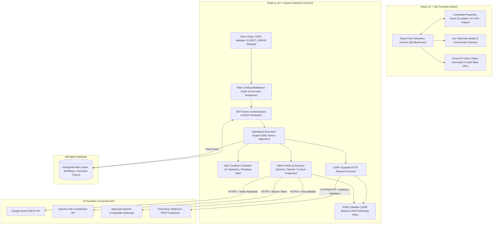

# FlowForge AI

> **Intelligent Fullstack Workflow Automation & AI Orchestration Platform**

FlowForge AI is a high-performance MERN workflow automation platform designed to visually orchestrate deterministic multi-step pipelines, evaluate complex conditional branching, and execute Large Language Model (LLM) reasoning tasks with enterprise security guardrails.

---

## 🏗️ Architecture Overview



---

## ✨ Core Engineering Features

### 1. Interactive Node Graph & Canvas
- **React Flow Canvas (`@xyflow/react`):** Drag-and-drop workflow canvas with custom styling, zoom/pan controls, connection validation, and dynamic port snapping.
- **Node Palette:**
  - **Webhook Trigger Node:** Ingests external HTTP events or manual payloads.
  - **Data Transform (Action) Node:** Deterministic data normalization and passthrough transformations.
  - **Rule Evaluator (Condition) Node:** Evaluates incoming payload attributes and routes execution across dedicated `TRUE` and `FALSE` handles.
  - **AI Anomaly Triage Node:** Dispatches structured prompts to Gemini or OpenAI models with upstream context interpolation.
  - **HTTP Request (API) Node:** Dispatches outbound HTTP/HTTPS requests with SSRF guards.
  - **Return Response (Output) Node:** Commits final pipeline state and aggregates upstream trace outputs.

### 2. Safe Condition Evaluator Service
- **14 Built-in Operators:** `equals`, `strict_equals`, `not_equals`, `greater_than`, `greater_than_or_equal`, `less_than`, `less_than_or_equal`, `contains`, `not_contains`, `starts_with`, `ends_with`, `is_empty`, `is_not_empty`, `is_true`, `is_false`.
- **Zero Arbitrary Code Execution:** Does not use `eval()`, `new Function()`, or dynamic code execution.
- **Prototype Pollution Prevention:** Explicitly blocks traversal into `__proto__`, `constructor`, `prototype`, or root object prototypes.
- **Safe Path Resolution:** Supports nested dot-notation (`data.user.tier`) and bracket notation (`items[0].id`) with graceful fallback for missing properties and `null` values.

### 3. Branch Reachability & Selective Skipping Engine
- **Deterministic Topological Sort:** Detects directed cycles (Kahn's algorithm) before execution dispatch.
- **Selective Branch Skipping:** Unselected branches are marked `SKIPPED` without executing downstream nodes, preventing wasted compute and unintended side effects.
- **Diamond DAG Convergence:** Re-joining DAG paths execute shared downstream nodes **exactly once** when reachable via the active path.

### 4. Standalone Backend AI Executor
- **Native Node.js v24 `fetch`:** Zero provider SDK bloat; leverages native `AbortController` and `ReadableStream`.
- **Multi-Provider Support:** Google Gemini REST API and OpenAI-compatible Chat Completions endpoints.
- **Strict Payload Guards:** Input payloads capped at 32 KB; streamed responses bounded at 512 KB to prevent memory exhaustion attacks.
- **Credential Redaction:** Automatically scrubs API keys (`AIza...`, `sk-...`, `Bearer...`, `?key=...`) from URLs, request headers, error messages, and telemetry traces.
- **Structured JSON vs. Text Modes:** Supports parsed JSON mode with schema guarantees and plain text mode with `structured: null`.

### 5. SSRF Defense-in-Depth
- **CIDR Address Blocks:** Rejects IPv4 private ranges (`10.0.0.0/8`, `172.16.0.0/12`, `192.168.0.0/16`), loopback (`127.0.0.0/8`), link-local/cloud metadata (`169.254.169.254`), carrier-grade NAT, and IPv6 unique local/link-local ranges.
- **DNS Rebinding Protection:** Pre-resolves target hostnames via `dns.promises.lookup` to ensure domain names do not resolve to internal IP addresses.
- **Redirect Re-validation:** Validates target URLs upon every redirect hop (up to 5 redirects).

### 6. Production Security & Deployment Hardening
- **Strict CORS Allowlist:** Replaces wildcard `*` with an environment-configured `CLIENT_ORIGIN` allowlist while supporting legitimate local development ports (`5173`, `3000`).
- **Database-Aware Health Checks:**
  - `GET /api/health`: Validates process state and MongoDB readiness probe (returns HTTP 503 if database disconnected).
  - `GET /api/health/liveness`: Process liveness probe.
  - `GET /api/health/readiness`: Dependency readiness probe.
  - Zero sensitive database URI, credential, or host details are exposed in responses.
- **Rate Limiting:** Protects `/api/auth/login`, `/api/auth/register`, and `/api/workflows/:id/execute` against credential stuffing, brute-force attacks, and AI inference quota exhaustion with HTTP 429 responses.
- **Container-Safe DNS:** Preserves cloud container internal networking by avoiding hardcoded external DNS servers in production.

---

## 🛠️ Tech Stack & Requirements

### System Requirements
- **Node.js**: `>= 20.0.0` (Node.js 24 LTS verified)
- **npm**: `>= 10.0.0`
- **Database**: MongoDB 6.0+ or MongoDB Atlas cluster

### Technology Breakdown
| Layer | Technologies |
| :--- | :--- |
| **Frontend** | React 19, Vite 8, Tailwind CSS 3, `@xyflow/react` 12, React Router 7, Axios, Lucide React |
| **Backend** | Node.js 24 (ESM), Express 4.21, Mongoose 8.9, bcryptjs, jsonwebtoken, express-rate-limit |
| **Security** | SSRF Validator, Kahn's DAG Validator, Prototype Pollution Shield, In-Memory Rate Limiter |

---

## ⚙️ Environment Variables

### Backend (`server/.env`)
Use `server/.env.example` as a template:

| Variable | Required | Description | Default / Example |
| :--- | :---: | :--- | :--- |
| `PORT` | No | Express server port | `5000` |
| `NODE_ENV` | Yes | Environment mode (`development` / `production` / `test`) | `development` |
| `MONGODB_URI` | Yes | MongoDB Atlas or local connection string | `mongodb+srv://...` |
| `JWT_SECRET` | Yes | Secret key used for signing JWT tokens | `your_secure_random_secret` |
| `JWT_EXPIRES_IN` | No | Token expiration duration | `1d` |
| `CLIENT_ORIGIN` | Yes | Allowed frontend origin(s) for CORS (comma-separated) | `http://localhost:5173` |
| `AUTH_RATE_LIMIT_WINDOW_MS` | No | Auth rate limit window in milliseconds | `900000` (15 min) |
| `AUTH_RATE_LIMIT_MAX` | No | Max auth attempts per window | `20` (prod), `1000` (dev) |
| `EXECUTION_RATE_LIMIT_WINDOW_MS` | No | Workflow execution rate limit window | `60000` (1 min) |
| `EXECUTION_RATE_LIMIT_MAX` | No | Max executions per window per user | `30` (prod), `1000` (dev) |
| `AI_PROVIDER` | No | Default AI provider (`gemini` or `openai`) | `gemini` |
| `GEMINI_API_KEY` | Optional* | Google Gemini API key (server-side only) | *(secret)* |
| `OPENAI_API_KEY` | Optional* | OpenAI API key (server-side only) | *(secret)* |
| `OPENAI_BASE_URL` | No | OpenAI-compatible custom endpoint base URL | `https://api.openai.com/v1` |
| `AI_ALLOWED_HOSTS` | No | Comma-separated additional approved HTTPS hostnames | `api.groq.com` |
| `DNS_SERVERS` | No | Optional comma-separated DNS IP overrides for custom networks | *(empty in prod)* |

*\*AI credentials are optional until live AI execution is requested. All AI keys remain strictly server-side.*

### Frontend (`client/.env`)
Use `client/.env.example` as a template:

| Variable | Required | Description | Default / Example |
| :--- | :---: | :--- | :--- |
| `VITE_API_BASE_URL` | Yes** | Public URL pointing to backend API `/api` base | `http://localhost:5000/api` |

*\*\*In Vite, this variable is inlined at build time. When deploying to production static hosts (Vercel, Netlify, Render Static), define `VITE_API_BASE_URL` in the build settings before initiating `npm run build`.*

---

## 🚀 Local Development Setup

### 1. Clone & Setup Backend
```bash
cd server
npm install
cp .env.example .env
# Edit .env with your MongoDB URI and JWT Secret
npm run dev
```
Backend API will start at: `http://localhost:5000`

### 2. Setup Frontend
```bash
cd client
npm install
cp .env.example .env
npm run dev
```
Frontend development server will start at: `http://localhost:5173`

---

## 🧪 Automated Testing & Results

FlowForge AI features a comprehensive regression test harness covering condition evaluation, graph topology, AI inference contracts, and deployment security.

### Test Execution Commands
```bash
# Run deployment readiness and security test suite (CORS, Health Checks, Rate Limiting):
node scratch/test_deployment_readiness.mjs

# Run full platform regression suites:
node scratch/test_condition_evaluator.mjs       # Safe condition evaluation (86 tests)
node scratch/test_condition_branching.mjs       # Branch reachability & diamond DAG (62 tests)
node scratch/test_ai_executor.mjs               # AI executor service (78 tests)
node scratch/test_ai_pipeline.mjs               # Workflow engine AI integration (61 tests)
node scratch/test_ai_end_to_end_verification.mjs# Full application AI E2E flow (36 tests)
node scratch/test_workflow_api.mjs              # MongoDB CRUD & IDOR isolation (16 tests)
```

### Verified Test Results Summary
| Test Suite | Purpose | Tests | Result |
| :--- | :--- | :---: | :---: |
| `test_deployment_readiness.mjs` | CORS, Health Probes (Liveness/Readiness), Rate Limiting | 51 | **51 / 51 PASSED** |
| `test_condition_evaluator.mjs` | 14 operators, prototype pollution, null handling | 86 | **86 / 86 PASSED** |
| `test_ai_executor.mjs` | Native fetch, stream limits, secret scrubbing, timeouts | 78 | **78 / 78 PASSED** |
| `test_condition_branching.mjs` | Branch reachability, selective skipping, diamond DAGs | 62 | **62 / 62 PASSED** |
| `test_ai_pipeline.mjs` | Execution engine AI integration, JSON mode, context passing | 61 | **61 / 61 PASSED** |
| `test_ai_end_to_end_verification.mjs` | Persistence, save/reload, live execution, honest failures | 36 | **36 / 36 PASSED** |
| `test_workflow_api.mjs` | Workflow persistence, validation, cross-user IDOR blocks | 16 | **16 / 16 PASSED** |
| **Total Automated Tests** | **Full Fullstack Regression Suite** | **390** | **390 / 390 PASSED (100%)** |

---

## 🚢 Recommended Production Deployment Plan

### Recommended Topology
1. **Frontend Hosting (Vercel / Netlify / Render Static):**
   - Root directory: `client`
   - Build command: `npm run build`
   - Publish directory: `client/dist`
   - Environment variable: `VITE_API_BASE_URL=https://<your-backend-domain>/api`
   - SPA rewrite rule: `/* -> /index.html`
2. **Backend Hosting (Render Web Service / Railway):**
   - Root directory: `server`
   - Build command: `npm install --omit=dev`
   - Start command: `npm start`
   - Environment variables: `NODE_ENV=production`, `PORT=5000`, `CLIENT_ORIGIN=https://<your-frontend-domain>`, `MONGODB_URI=...`, `JWT_SECRET=...`
3. **Database (MongoDB Atlas):**
   - Managed replica set cluster with TLS encryption.

---

## ⚠️ Known Limitations & Honest Disclosures

1. **Live AI Provider Verification:**
   - The standalone AI executor service (`aiExecutor.js`) and workflow pipeline engine are verified against mock provider contracts (testing request schemas, token counting, timeout aborts, payload bounds, and JSON parsing).
   - **Live model inference against an active external billing account (real Google Gemini or OpenAI paid API key) has not yet been executed** because provider API keys were not configured in the local development environment.
2. **Rate Limiting Scope:**
   - The current rate limiting implementation uses Node.js in-memory storage (`express-rate-limit`).
   - Limits are tracked per Node process. When horizontally scaled across multiple container instances or serverless functions, rate limits are not shared across instances. For distributed multi-instance production deployments, configure a shared Redis store via `rate-limit-redis`.
3. **JWT Client Storage:**
   - Tokens are currently stored in browser `localStorage` and sent via Axios request interceptors (`Authorization: Bearer <token>`).
   - For enterprise environments requiring strict XSS immunity, migrating to `httpOnly`, `SameSite=Strict` secure cookies is recommended.
