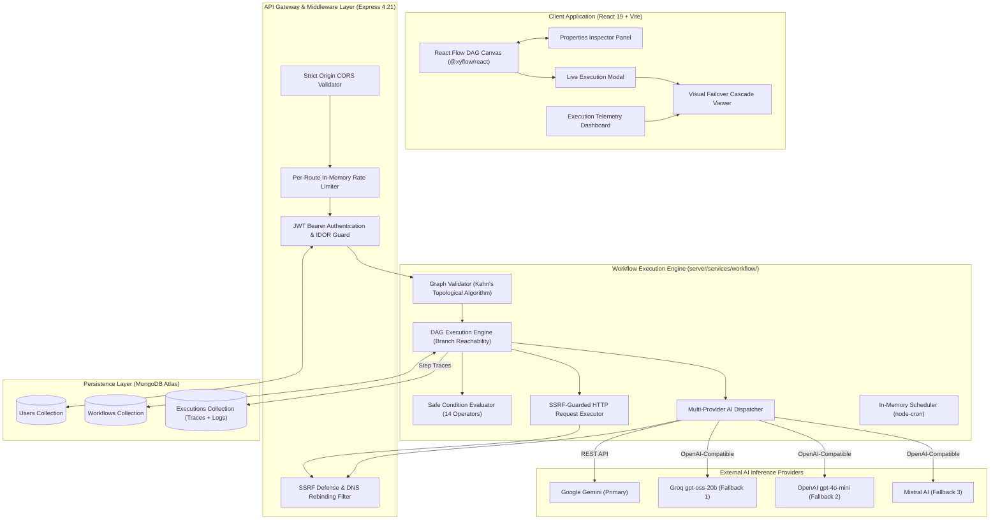
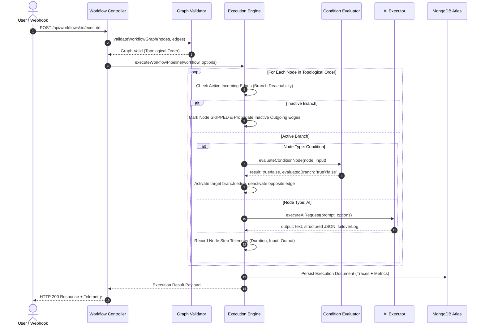
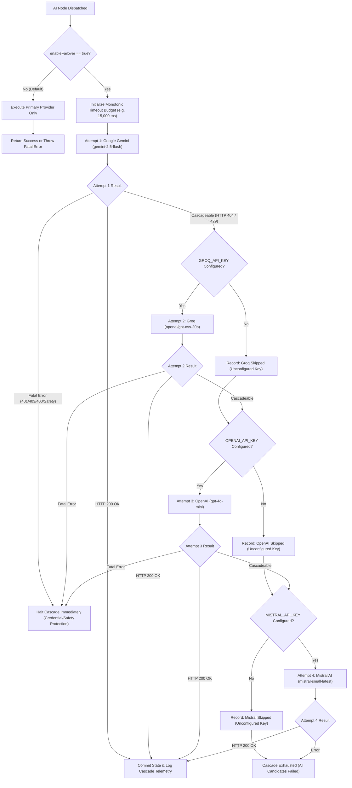
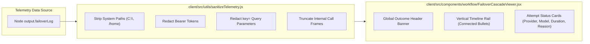
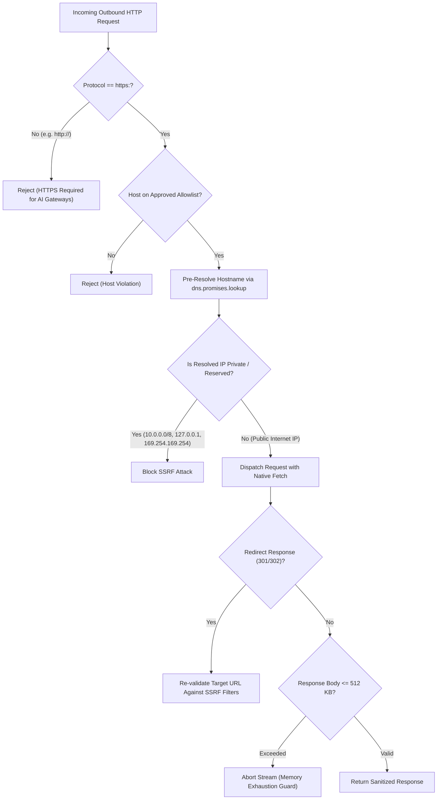
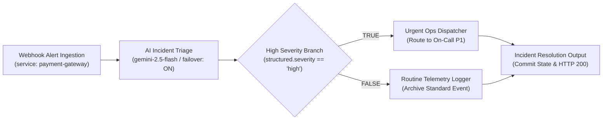

# FlowForge AI — System Architecture & Engineering Specifications

> **Technical Architecture Reference for Senior Software Engineers, Systems Reviewers, and Interviewers**  
> Repository: `https://github.com/DivyanshuG23/flowforge-ai`  
> Live Deployment: [Frontend (Vercel)](https://flowforge-ai-ten.vercel.app) &bull; [Backend (Render)](https://flowforge-ai-api-hj63.onrender.com) &bull; Managed Database: MongoDB Atlas

---

## 1. System Overview & Engineering Philosophy

FlowForge AI is an enterprise-oriented workflow automation platform designed to execute complex, multi-step Directed Acyclic Graphs (DAGs) combining external webhooks, deterministic condition logic, outbound API requests, and multi-model Large Language Model (LLM) reasoning.



### Core Design Principles
1. **Deterministic Execution:** Graph cycles are detected and rejected prior to dispatch using Kahn's algorithm. Branching logic evaluates strictly without dynamic code evaluation (`eval` or `new Function`).
2. **Resilience Without Hallucination:** If an upstream AI provider deprecates a model or throttles requests, the engine automatically cascades to fallback providers within a single monotonic timeout budget. If all fail, the error is honestly reported—never fabricated.
3. **Defense-in-Depth Security:** Every outbound network request passes through private IP CIDR filters, DNS rebinding checks, and redirect re-validation. Credentials are scrubbed from telemetry before persistence.
4. **Step-by-Step Observability:** Millisecond durations, input payloads, structured outputs, prompt/completion token consumption, and failover candidate attempt logs are captured for every executed node.

---

## 2. Directed Acyclic Graph (DAG) Execution Engine

The workflow engine executes pipelines in topological order, supporting diamond dependencies, selective branch reachability, and conditional branching.



### A. Graph Validation (`graphValidator.js`)
- **Topological Sorting:** Employs Kahn’s algorithm to calculate node in-degrees and resolve execution order.
- **Cycle Detection:** Identifies directed cycles and returns human-readable error messages detailing cycle membership.
- **Isolated Component Validation:** Ensures every node is reachable from an entrypoint. Multiple entrypoints (e.g., parallel triggers) and multiple terminal exits are supported.

### B. Branch Reachability & Selective Skipping (`executionEngine.js`)
- **Condition Edges:** Condition nodes have two designated source handles: `'true'` and `'false'`.
- **Edge Activation:** Upon condition resolution, only edges originating from the evaluated branch are added to the `activeEdgeKeys` set; opposite edges are placed in `inactiveEdgeKeys`.
- **Selective Skipping:** If a node has incoming connections but none originate from an active edge, it is marked `status: 'skipped'` with duration `0ms`. Skipping propagates transitively downstream.
- **Diamond DAG Convergence:** When multiple paths converge into a downstream node, the node aggregates inputs strictly from active parents and executes **exactly once**.

---

## 3. Multi-Provider AI Failover Architecture

The AI subsystem (`server/services/workflow/aiExecutor.js`) implements a four-provider cascade designed to survive upstream model retirements and transient API failures.



### Provider Cascade Order
1. **Google Gemini (Primary):** `gemini-2.5-flash` (REST API).
2. **Groq (Fallback 1):** `openai/gpt-oss-20b` (OpenAI-compatible REST API).
3. **OpenAI (Fallback 2):** `gpt-4o-mini` (OpenAI Chat Completions API).
4. **Mistral AI (Fallback 3):** `mistral-small-latest` (OpenAI-compatible REST API).

### Cascade Mechanics & Error Classification
- **Monotonic Global Timeout Budget:** A single timeout deadline (default: 15,000 ms) governs the entire node execution. Each candidate provider attempt subtracts elapsed time; no attempt can overrun the remaining global budget.
- **Cascadeable Errors:**
  - Upstream Model Retirement / Availability: HTTP 404 (e.g., deprecated model ID).
  - Provider Rate Limit: HTTP 429 (when retries are exhausted).
  - Service Unavailability: HTTP 503 / 502 / 504.
- **Non-Cascadeable Fatal Errors:**
  - Authentication / Authorization: HTTP 401 / 403 (halts immediately to prevent credential abuse).
  - Malformed User Request: HTTP 400 Bad Request.
  - Safety Rejection: Gemini content moderation / safety blocks (halts immediately to avoid circumventing safety filters).
- **Graceful Unconfigured Key Skipping:** If an optional fallback key (e.g., `GROQ_API_KEY`) is missing from `process.env`, the executor logs `{ provider: 'groq', status: 'skipped', reason: 'GROQ_API_KEY is not configured on server' }` and immediately advances to the next candidate without throwing an unhandled exception.
- **Bounded Exponential Backoff with Jitter:** For retryable HTTP statuses (429, 503), the engine performs up to 2 retries per provider with exponential backoff (`delay = min(5000, 1000 * 2^attempt)`) plus up to 30% randomized jitter.

---

## 4. Visual Failover Cascade Viewer Architecture

Telemetry from the AI executor is stored in MongoDB as an array of attempt records (`step.output.failoverLog`) and rendered on the client via `FailoverCascadeViewer.jsx`.



### Operational States Visualized
| Attempt State | Visual Badge & Palette Token | Meaning |
| :--- | :--- | :--- |
| **Success &bull; Recovered** | `bg-[#059669]/15 text-[#059669] border-[#059669]/30` | Fallback candidate succeeded and recovered the pipeline run. |
| **Model Unavailable (HTTP 404)** | `bg-[#C83C3C]/15 text-[#E5B45B] border-[#C83C3C]/30` | Upstream provider deprecated or retired model; triggered cascade. |
| **Skipped &bull; Unconfigured Key** | `bg-[#151715] text-[#B9B0A0] border-[rgba(185,176,160,0.18)]` | Server environment lacked API key; cleanly bypassed. |
| **Rate Limit (HTTP 429)** | `bg-[#252419] text-[#E5B45B] border-[rgba(229,180,91,0.3)]` | Provider quota reached; cooldown requested. |
| **Auth Error (HTTP 401/403)** | `bg-[#C83C3C]/15 text-[#C83C3C] border-[#C83C3C]/30` | Invalid credentials; halted cascade. |
| **Timeout Budget Exhausted** | `bg-[#C83C3C]/15 text-[#C83C3C] border-[#C83C3C]/30` | Total monotonic budget reached before provider returned. |

---

## 5. Security Architecture & Boundary Defenses



### Security Guardrails
1. **Server-Side Credential Storage:** API keys (`GEMINI_API_KEY`, `GROQ_API_KEY`, `OPENAI_API_KEY`, `MISTRAL_API_KEY`) are stored strictly in backend `process.env`. They are never stored in workflow JSON, database node documents, or browser bundles.
2. **SSRF Defense-in-Depth (`ssrfValidator.js`):**
   - Private CIDR block rejection: `10.0.0.0/8`, `172.16.0.0/12`, `192.168.0.0/16`.
   - Loopback & Link-Local: `127.0.0.0/8`, `169.254.169.254` (cloud metadata endpoints like AWS IMDSv1).
   - DNS Rebinding Filter: Pre-resolves domain names to IP addresses prior to connecting.
   - Redirect Re-validation: Re-runs validation on every HTTP redirect hop (up to 5 redirects).
3. **Payload & Stream Bounds:**
   - Input Payload: Capped at 32 KB (`MAX_INPUT_BYTES`).
   - Response Stream: Bounded at 512 KB (`MAX_RESPONSE_BYTES`) to prevent memory exhaustion attacks.
4. **Prototype Pollution Protection (`conditionEvaluator.js`):**
   - Explicitly rejects property paths referencing `__proto__`, `prototype`, or `constructor`.
5. **Multi-Tenant Data Isolation (IDOR Defense):**
   - Every database query in `workflowController.js` and `executionController.js` includes `{ user: req.user.id }`. Users cannot read, modify, or execute workflows owned by other tenants.

---

## 6. Flagship Demo Guide: AI Incident Triage & Smart Recovery

The flagship blueprint demonstrates a production incident triage pipeline that showcases visual DAG routing, AI reasoning, deterministic branching, and failover recovery in under 3 minutes.



### Topology & Node Sequence
1. **Node 1 (`node-trigger-1`):** Webhook Alert Ingestion
   - Default Payload:
     ```json
     {
       "service": "payment-gateway",
       "errorRatePercent": 14.8,
       "latencyP99Ms": 2450,
       "message": "Database connection pool exhausted during transaction commit"
     }
     ```
2. **Node 2 (`node-ai-1`):** AI Incident Triage
   - Model: `gemini-2.5-flash` &bull; Output: Structured JSON (`{ severity: "high" | "low", reason: string, recommendedAction: string }`).
   - Failover: `enableFailover: true`.
3. **Node 3 (`node-condition-1`):** High Severity Branch
   - Rule: `field: 'structured.severity'`, `operator: 'equals'`, `value: 'high'`.
4. **Node 4 (`node-action-high`):** Urgent Ops Dispatcher (evaluated when condition is `TRUE`).
5. **Node 5 (`node-action-routine`):** Routine Telemetry Logger (marked `status: 'skipped'` when condition is `TRUE`).
6. **Node 6 (`node-output-1`):** Incident Resolution Output (commits state and returns HTTP 200).

### Interview Demonstration Walkthrough
1. **Open Blueprint:** Navigate to **Templates** &rarr; select **AI Incident Triage & Smart Recovery** &rarr; click **Use as Blueprint**.
2. **Inspect Node Configuration:**
   - Click the AI node &rarr; observe the prompt with structured JSON formatting instructions and the active **Automatic AI Failover** toggle.
   - Click the Condition node &rarr; observe the rule binding (`structured.severity == high`).
3. **Execute Pipeline:**
   - Click **Run** on the canvas header.
   - Observe real-time execution animation: `Trigger (1ms)` &rarr; `AI (~500ms)` &rarr; `Condition (1ms)` &rarr; `Urgent Ops (1ms)` &rarr; `Output (1ms)`.
   - Point out that `Routine Telemetry Logger` is visually marked **Skipped** with a muted border.
4. **Inspect Failover Telemetry:**
   - In the Execution Result modal, point to the step telemetry card.
   - If executed on a server where Gemini returns a model retirement notice (HTTP 404), point out how Groq recovered the pipeline, rendering the emerald `Success • Recovered` badge and the canvas subtitle update: `gemini ➔ groq (openai/gpt-oss-20b)`.
   - Explain how credentials, file paths, and tokens are scrubbed from the diagnostic detail box.

---

## 7. Data Models & Schemas

### A. Execution Schema (`server/models/Execution.js`)
```javascript
{
  workflow: ObjectId (ref: 'Workflow', required, index),
  user: ObjectId (ref: 'User', required, index),
  status: String (enum: ['queued', 'running', 'succeeded', 'failed'], index),
  startedAt: Date,
  completedAt: Date,
  durationMs: Number,
  nodeExecutions: [
    {
      nodeId: String,
      nodeType: String,
      nodeLabel: String,
      status: String (enum: ['pending', 'running', 'succeeded', 'failed', 'skipped']),
      startedAt: Date,
      completedAt: Date,
      durationMs: Number,
      input: Mixed,
      output: Mixed, // Contains structured JSON, text, and failoverLog: []
      error: String
    }
  ],
  triggerSource: String (enum: ['manual', 'scheduled', 'webhook', 'rerun']),
  rerunFrom: ObjectId (ref: 'Execution', optional),
  triggerData: Mixed,
  error: String
}
```

---

## 8. Architectural Disclosures & Limitations

1. **In-Memory Rate Limiting:**
   - Rate limiting (`express-rate-limit`) is stored in Node.js process memory. In horizontally scaled multi-container clusters, counters are not shared across instances. Production scaling requires configuring `rate-limit-redis`.
2. **In-Memory Scheduler:**
   - Scheduled workflows (`schedulerService.js`) utilize `node-cron` in-process. In multi-instance deployments, running multiple container replicas would cause duplicate schedule firings without a distributed lock (e.g., Redis Redlock) or dedicated job queue (e.g., BullMQ).
3. **JWT Client Storage:**
   - Tokens are stored in browser `localStorage`. For enterprise environments requiring strict XSS immunity, tokens should be transitioned to `httpOnly`, `SameSite=Strict` secure cookies.
4. **Live Provider API Prerequisites:**
   - Live AI fallback execution in production depends on server environment variable configuration (e.g., `GROQ_API_KEY`). If optional fallback keys are not provisioned, the engine cleanly skips unconfigured providers and reports the primary provider error.
